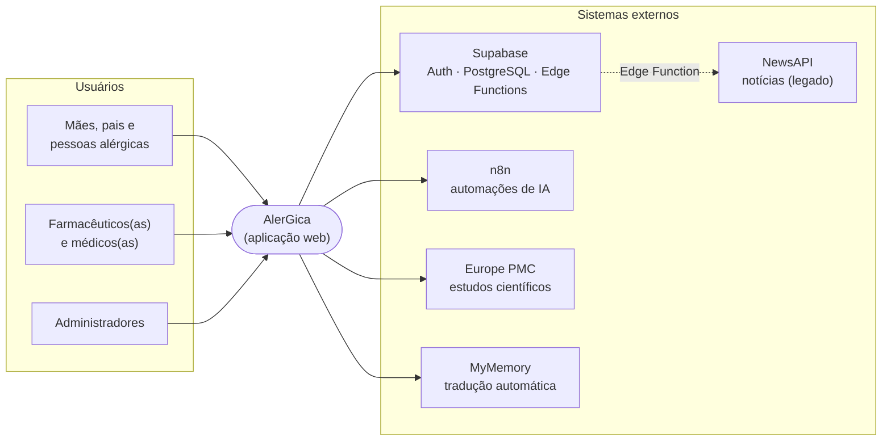
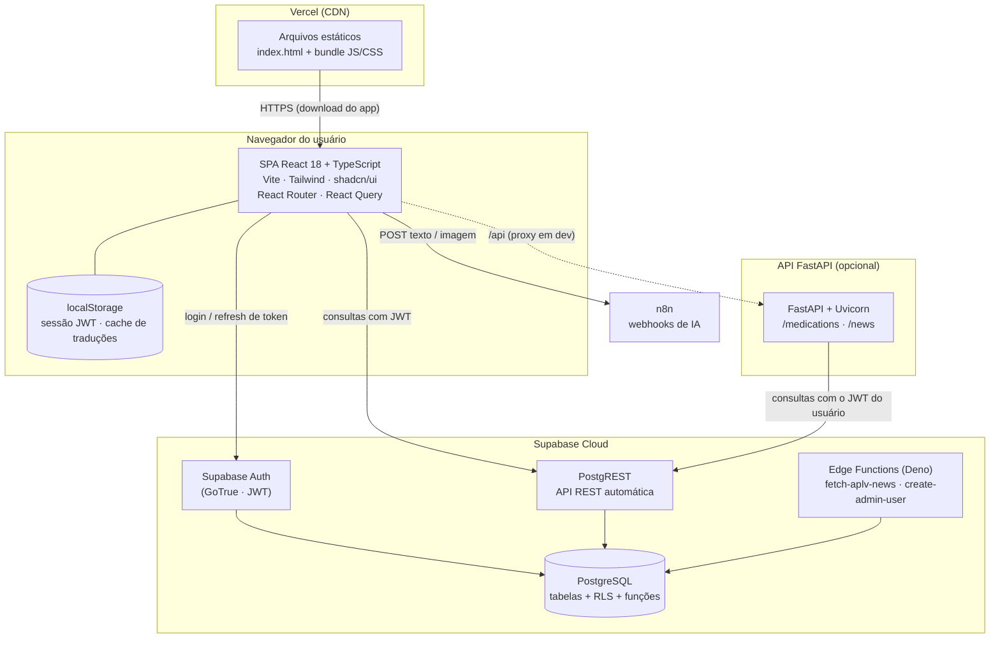
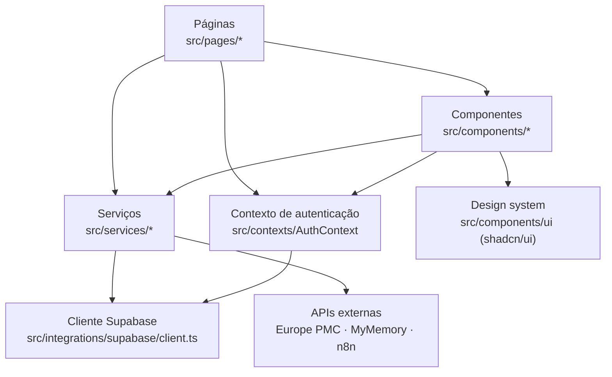
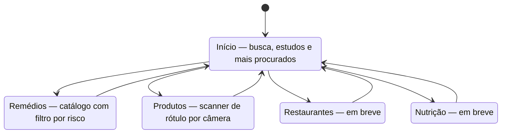
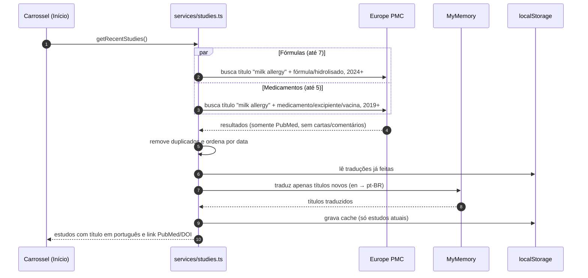
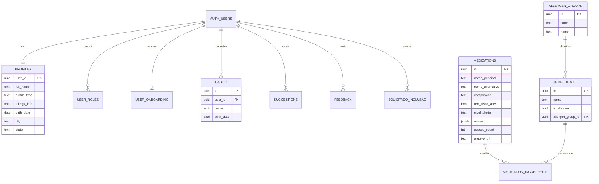
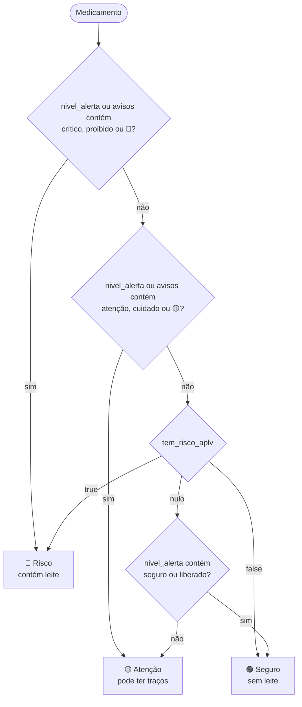
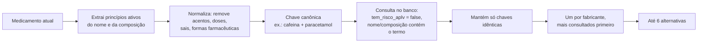
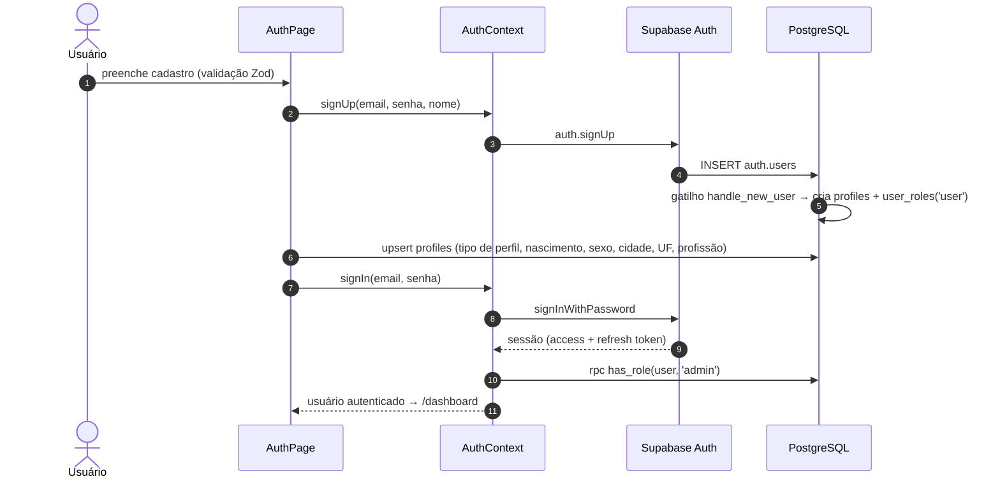
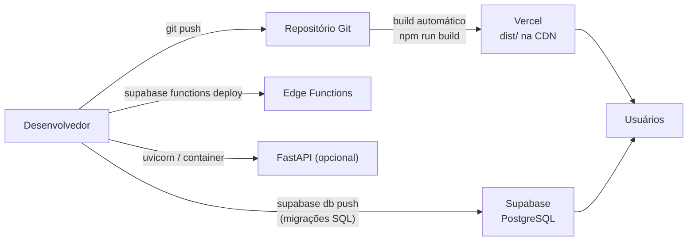

# Arquitetura do Sistema AlerGica

## 1. Sumário executivo

O **AlerGica** é uma plataforma web (SPA, *mobile-first*) que ajuda famílias de crianças com **APLV — Alergia à Proteína do Leite de Vaca** a identificar medicamentos e produtos seguros. O núcleo do produto é um **catálogo de medicamentos com classificação de risco** (seguro / atenção / risco), extraída das bulas oficiais, complementado por:

- busca instantânea por nome comercial, genérico ou composição;
- página de detalhe com composição, excipientes de origem láctea destacados e link para a bula original;
- **sugestão automática de alternativas seguras** (mesmo princípio ativo, outro fabricante, sem leite);
- verificação de **produtos alimentícios por foto** do rótulo, com análise por IA;
- conteúdo educativo com fontes científicas e feed de estudos recentes traduzidos para português;
- perfil do usuário, cadastro de bebês e canal de suporte/sugestões.

A arquitetura é **serverless-first**: o frontend React é servido estaticamente (Vercel) e conversa diretamente com o **Supabase** (PostgreSQL + Auth + API REST automática), com a segurança garantida por **Row-Level Security (RLS)** no banco. Integrações de IA são orquestradas por **n8n** via webhooks. Há ainda um serviço **FastAPI** (Python) preparado para regras de negócio no servidor, hoje em estágio inicial.

| Atributo | Decisão |
|---|---|
| Estilo arquitetural | SPA + Backend-as-a-Service (BaaS) + automações por webhook |
| Linguagens | TypeScript (frontend, Edge Functions), Python (API FastAPI), SQL (banco) |
| Banco de dados | PostgreSQL gerenciado (Supabase) |
| Autenticação | Supabase Auth (e-mail e senha, JWT) |
| Autorização | RLS por usuário + papéis (`admin`, `moderator`, `user`) |
| Hospedagem | Vercel (frontend) · Supabase Cloud (dados, auth, funções) |
| IA | n8n (webhooks) para análise de alergias e leitura de rótulos |
| Idioma da interface | Português do Brasil |

## 2. Princípios arquiteturais

1. **Segurança no dado, não só na tela.** Toda tabela tem RLS ativada. Mesmo que o frontend seja contornado, o banco só entrega o que o usuário autenticado pode ver.
2. **Camada de serviços no frontend.** Componentes de tela não falam com APIs diretamente: chamam funções em `src/services/`, que concentram consultas, regras de classificação e integrações.
3. **Menor infraestrutura possível.** Sem servidores próprios para operar no caminho crítico: o Supabase expõe o banco por REST e o frontend é estático. Isso reduz custo e superfície operacional.
4. **Falhar de forma segura.** Em uma aplicação de saúde, a dúvida deve resultar em "Atenção", nunca em "Seguro". A regra de classificação usa `caution` como padrão quando os dados são insuficientes.
5. **Extensível para outros alérgenos.** O modelo normalizado (`allergen_groups`, `ingredients`, `medication_ingredients`) já prevê glúten, soja, ovo e lactose, permitindo expandir além da APLV.
6. **Português em primeiro lugar.** Toda a interface, mensagens de erro e conteúdo científico (traduzido automaticamente) estão em pt-BR.

## 3. Visão de contexto

Quem usa o sistema e com quais sistemas externos ele se relaciona.

| Ator / sistema | Papel |
|---|---|
| Mães, pais, pessoa alérgica | Público principal. Consulta medicamentos, verifica produtos, gerencia perfil e bebês. |
| Profissionais de saúde | Mesmo acesso, com interface ajustada (ocultação de pontos de análise da IA voltados a leigos). |
| Administradores | Gerenciam catálogo e papéis via banco (políticas `admin`). |
| Supabase | Autenticação, banco PostgreSQL, API REST (PostgREST), funções RPC e Edge Functions. |
| n8n | Recebe texto/imagem por webhook e devolve análise por IA (perfil de alergias e leitura de rótulos). |
| Europe PMC | Fonte pública (indexa o PubMed) dos estudos recentes exibidos na tela inicial. |
| MyMemory | Tradução dos títulos dos estudos do inglês para o português. |
| NewsAPI | Fonte de notícias usada pela Edge Function `fetch-aplv-news` (não exibida na versão atual). |

## 4. Visão de containers

| Container | Tecnologia | Responsabilidade | Estado |
|---|---|---|---|
| SPA | React 18, TypeScript, Vite 5 | Interface, roteamento, regras de apresentação e classificação de risco | Produção |
| Hospedagem estática | Vercel | Entrega do app; reescreve todas as rotas para `index.html` | Produção |
| Supabase Auth | GoTrue | Cadastro, login, emissão e renovação de JWT | Produção |
| PostgREST | Supabase | Expõe as tabelas como API REST, aplicando RLS | Produção |
| PostgreSQL | Supabase | Dados de usuários, catálogo, conteúdo e auditoria básica | Produção |
| Edge Functions | Deno | Cache de notícias; criação de administradores (restrita a `admin`) | Implantadas, uso pontual |
| API FastAPI | Python 3, FastAPI | Camada de regras de negócio no servidor | Em desenvolvimento — ainda não usada pelo frontend |
| n8n | n8n (externo) | Orquestra chamadas de IA | Produção (dependência externa) |

## 5. Arquitetura do frontend

### 5.1 Camadas

| Camada | Pasta | O que contém |
|---|---|---|
| Entrada | `src/main.tsx`, `src/App.tsx` | Montagem do React, provedores globais (React Query, Tooltip, Auth, Toasts) e rotas |
| Páginas | `src/pages/` | Uma tela por rota: autenticação, painel, detalhe do medicamento, perfil, configurações, 404 |
| Componentes | `src/components/` | Blocos de interface reutilizáveis (cards, barra lateral, menu inferior, scanner, widget de suporte) |
| Design system | `src/components/ui/` | Componentes base shadcn/ui sobre Radix UI |
| Serviços | `src/services/` | Acesso a dados e regras: `medications.ts`, `studies.ts`, `api.ts` |
| Contexto | `src/contexts/AuthContext.tsx` | Sessão, usuário, flag de administrador, login/cadastro/saída |
| Integração | `src/integrations/supabase/` | Cliente Supabase e tipos gerados do banco |
| Estilos | `src/index.css`, `tailwind.config.ts` | Tokens de cor (claro/escuro), sombras, animações |

### 5.2 Mapa de rotas

| Rota | Página | Acesso | Observação |
|---|---|---|---|
| `/` | `AuthPage` | Público | Login e cadastro; redireciona ao painel se já autenticado |
| `/dashboard` | `Dashboard` | Autenticado | Módulos: Início, Remédios, Produtos, Restaurantes, Nutrição |
| `/medication/:id` | `MedicationDetails` | Autenticado* | Detalhe, composição e alternativas seguras |
| `/profile` | `ProfilePage` | Autenticado | Dados pessoais e bebês |
| `/settings` | `SettingsPage` | Autenticado* | Preferências (conteúdo informativo nesta versão) |
| `*` | `NotFound` | Público | Página 404 |

\* A página não redireciona sozinha quem não está logado; os dados continuam protegidos pela RLS do banco (a consulta retorna vazio). Ver seção 13.

### 5.3 Navegação no painel

O painel (`/dashboard`) é uma única página com **módulos** alternados pelo menu inferior expansível (`ExpandableTabs`). A troca de módulo não muda a URL — é estado local da página.

### 5.4 Gerenciamento de estado

- **Sessão:** `AuthContext` assina `onAuthStateChange` do Supabase e expõe `user`, `session`, `loading` e `isAdmin` (via RPC `has_role`). A sessão é persistida em `localStorage` com renovação automática do token.
- **Dados de tela:** estado local (`useState`/`useEffect`) por página. O `QueryClient` do TanStack React Query está configurado na raiz e disponível para adoção gradual.
- **Cache no navegador:** traduções de títulos de estudos ficam em `localStorage` (chave `alergica:study-title-pt`), mantendo apenas os estudos atuais.
- **Busca:** campo com *debounce* de 400 ms antes de consultar o banco.

## 6. Arquitetura de backend

### 6.1 Supabase (caminho principal)

O frontend usa o SDK `@supabase/supabase-js` para todas as operações de dados. Cada requisição carrega o JWT do usuário; o PostgREST repassa a identidade ao PostgreSQL, que aplica as políticas de RLS.

| Recurso | Uso no AlerGica |
|---|---|
| **Auth** | Cadastro com e-mail e senha, login, sessão persistente. Confirmação de e-mail está desativada (login automático após o cadastro). |
| **PostgREST** | Leitura do catálogo, CRUD de perfil, bebês, sugestões, feedback e onboarding. |
| **Funções SQL (RPC)** | `has_role` (verifica papel), `increment_medication_access` (contador de acessos), `handle_new_user` (gatilho de cadastro). |
| **Gatilhos** | Criação automática de perfil e papel `user` ao cadastrar; atualização de `updated_at`. |
| **Edge Functions** | `fetch-aplv-news` (notícias com cache de 24 h) e `create-admin-user` (criação de usuários e administradores; só pode ser chamada por um `admin` autenticado). |
| **Storage** | Previsto para imagens de solicitações de inclusão (`solicitado_inclusao.imagem_url`). |

### 6.2 API FastAPI (camada de servidor)

Localizada em `backend/`, foi desenhada para concentrar regras de negócio no servidor, seguindo o padrão **routers finos → services**. Ela não cria um sistema de autenticação próprio: recebe o JWT do Supabase no cabeçalho `Authorization` e o repassa ao banco, de modo que a RLS continua valendo.

| Endpoint | Descrição |
|---|---|
| `GET /medications/search?q=&limit=` | Busca medicamentos; sem `q`, devolve os 6 mais acessados |
| `GET /medications/{id}` | Detalhe com composição normalizada (ingredientes e grupos alergênicos) |
| `POST /medications/{id}/view` | Incrementa o contador de acessos |
| `GET /news` | Notícias sobre APLV via NewsAPI (chave guardada no servidor) |

Em desenvolvimento, o Vite encaminha `/api/*` para `http://localhost:8000`. **Na versão atual o frontend não chama essa API** — todas as telas usam o Supabase diretamente. O plano de evolução (seção 12) prevê migrar a lógica de classificação e de alternativas para cá.

## 7. Integrações externas

| Integração | Onde é usada | Protocolo | Autenticação | Comportamento em falha |
|---|---|---|---|---|
| **n8n — perfil de alergias** | Onboarding (`OnboardingModal`) | `POST` JSON `{ allergies }` | URL secreta do webhook (`VITE_N8N_WEBHOOK_URL`) | Mensagem de erro e opção de tentar de novo |
| **n8n — leitura de rótulo** | Módulo Produtos (`ProductScanner`) | `POST` multipart com a foto (`image`) | Mesmo webhook | Tela de erro com "Tentar novamente"; nenhum resultado é exibido |
| **Europe PMC** | Carrossel de estudos (`services/studies.ts`) | `GET` REST público | Nenhuma | Categoria com erro é ignorada; restante é exibido |
| **MyMemory** | Tradução dos títulos dos estudos | `GET` REST público | Nenhuma | Mantém o título original em inglês (tempo limite de 4 s) |
| **NewsAPI** | Edge Function e FastAPI `/news` | `GET` REST | Chave no servidor (`NEWS_API_KEY`) | Lista vazia |

### 7.1 Feed de estudos científicos

## 8. Arquitetura de dados

### 8.1 Visão geral

O banco tem dois grupos de tabelas:

- **Dados do usuário** — perfil, papéis, onboarding, bebês, sugestões e feedback. Cada linha pertence a um `user_id` e só o dono acessa.
- **Catálogo** — medicamentos (e, futuramente, produtos e restaurantes), legível por qualquer usuário autenticado e gravável apenas por administradores.

O dicionário de dados completo, coluna a coluna, está no documento **Documentação Técnica do Sistema**.

### 8.2 Origem do catálogo de medicamentos

O catálogo em produção é alimentado por um **processo de extração de bulas** (fora deste repositório): cada bula oficial é lida, a composição é separada em princípio ativo e excipientes, e uma análise identifica termos lácteos. O resultado preenche:

| Campo | Conteúdo |
|---|---|
| `composicao` | Texto da composição: ativos, depois `. Excipientes:` e a lista |
| `termos_encontrados` | Termos de origem láctea encontrados na bula |
| `tem_risco_aplv` | `true` se contém leite, `false` se não contém, `null` se indefinido |
| `nivel_alerta` | Rótulo textual (ex.: `VERDE`, `AMARELO`, `VERMELHO`) |
| `avisos`, `detalhes_criticos`, `detalhes_atencao` | Mensagens da análise por IA |
| `arquivo_url`, `data_extracao` | Link do PDF da bula e data da análise |

### 8.3 Modelo normalizado (evolução multi-alérgeno)

As migrações também criam um modelo normalizado — `allergen_groups` → `ingredients` → `medication_ingredients` — com grupos pré-cadastrados para **leite (MILK)**, **lactose**, **glúten**, **soja** e **ovo**. Esse modelo é a base para a fase de múltiplas alergias: em vez de procurar palavras na composição, cada ingrediente aponta para o grupo alergênico, e a classificação passa a ser calculada conforme as alergias do perfil.

## 9. Regras de negócio centrais

### 9.1 Classificação de risco

A função `medToRisk` (`src/services/medications.ts`) converte os campos do catálogo em um dos três níveis exibidos ao usuário. A ordem das verificações importa: sinais de risco vencem sinais de segurança, e a ausência de informação resulta em **Atenção**.

| Nível | Código | Cor | Mensagem ao usuário |
|---|---|---|---|
| Seguro | `safe` | Verde | "Sem derivados do leite" |
| Atenção | `caution` | Amarelo | "Verifique com o farmacêutico" |
| Risco | `risk` | Vermelho | "Contém derivados do leite" |

### 9.2 Destaque de excipientes lácteos

Na página de detalhe, a composição é dividida em **princípio ativo** e **excipientes**. Cada excipiente é comparado (sem acentos, sem diferenciar maiúsculas) com uma lista de termos lácteos — leite, lactose, caseína, caseinato, lactoalbumina, lactoglobulina, soro de leite, whey, manteiga, lactulose — somada aos termos que a análise da bula encontrou. Os que batem são destacados em vermelho.

### 9.3 Alternativas seguras

Quando um medicamento é **Atenção** ou **Risco**, o sistema procura outros com **exatamente os mesmos princípios ativos** e sem leite.

A normalização ignora sais e hidratos (cloridrato, sódico, mono-hidratado…), formas (comprimido, gotas, xarope…), dosagens e prefixos de laboratórios públicos (ex.: `furp-`). A busca no banco ignora acentos trocando vogais e "c" por curinga de um caractere. A interface sempre alerta que dose, forma e indicação podem diferir e que a troca exige orientação profissional.

### 9.4 Popularidade

Cada abertura de detalhe chama a função `increment_medication_access` (RPC `SECURITY DEFINER`), que soma 1 em `access_count` sem dar ao usuário permissão de escrita na tabela. A seção "Mais Procurados" ordena por esse contador.

### 9.5 Personalização por perfil

| Perfil (`profile_type`) | Efeito na interface |
|---|---|
| `mae`, `pai` | Exibe o gerenciador de bebês no perfil |
| `alergica` | Experiência padrão |
| `farmaceutico`, `medico` | Pula a etapa de IA do onboarding; oculta "Pontos críticos" e "Pontos de atenção" da análise automática no detalhe do medicamento |

## 10. Segurança

### 10.1 Autenticação

- Senhas: mínimo de 8 caracteres (validação no cliente) e armazenamento com hash pelo Supabase Auth.
- Tokens: JWT de curta duração com *refresh token*, renovados automaticamente pelo SDK.
- Sessão persistida em `localStorage`.

### 10.2 Autorização (RLS e papéis)

| Tabela | Leitura | Escrita |
|---|---|---|
| `profiles`, `babies`, `user_onboarding` | Somente o dono | Somente o dono |
| `suggestions`, `feedback` | Somente o dono | Inserção pelo dono |
| `user_roles` | O próprio usuário | Somente `admin` |
| `medications`, `ingredients`, `allergen_groups`, `medication_ingredients` | Qualquer usuário autenticado | Somente `admin` |
| `news_cache` | Público | Somente `admin` (e Edge Function com chave de serviço) |

Papéis ficam em tabela separada (`user_roles`, enum `app_role`), e a checagem usa a função `has_role` com `SECURITY DEFINER`, o que evita recursão de políticas e impede que um usuário altere o próprio papel.

### 10.3 Segredos e configuração

| Variável | Onde | Exposição |
|---|---|---|
| `VITE_SUPABASE_URL`, `VITE_SUPABASE_ANON_KEY` | Frontend | Pública por natureza (protegida por RLS) |
| `VITE_N8N_WEBHOOK_URL` | Frontend | Visível no navegador — ver seção 13 |
| `SUPABASE_URL`, `SUPABASE_ANON_KEY`, `NEWS_API_KEY` | `backend/.env` | Apenas servidor |
| `SUPABASE_SERVICE_ROLE_KEY`, `NEWS_API_KEY` | Segredos das Edge Functions | Apenas servidor |

Arquivos `.env` estão no `.gitignore`.

### 10.4 Privacidade e LGPD

O sistema trata **dados pessoais sensíveis de saúde** (alergias, observações, dados de crianças), enquadrados no art. 11 da LGPD. A arquitetura já oferece isolamento por usuário via RLS. Para comercialização recomenda-se: termo de consentimento específico no cadastro, política de privacidade, registro das operações de tratamento, rotina de exclusão de conta e dados, e acordo de processamento de dados com os provedores (Supabase, Vercel, n8n e o provedor de IA usado no n8n).

## 11. Implantação e operação

| Ambiente | Frontend | Backend |
|---|---|---|
| Desenvolvimento | `npm run dev` — Vite em `http://localhost:8080` (proxy `/api` → `:8000`) | Supabase Cloud; FastAPI com `uvicorn app.main:app --reload` |
| Pré-visualização local | `npm run build` + `node serve.mjs` em `http://localhost:3000` | — |
| Produção | Vercel (SPA com reescrita de rotas para `index.html`) | Supabase Cloud |

- **Migrações:** um arquivo SQL por mudança em `supabase/migrations/`, nomeado por data e hora.
- **Escalabilidade:** frontend estático em CDN escala sem esforço; o gargalo potencial é o banco, que escala verticalmente no Supabase. As consultas do catálogo usam `ILIKE` e se beneficiam de índices trigram (`pg_trgm`) quando o catálogo crescer.
- **Observabilidade:** logs de Auth, PostgREST e Edge Functions no painel do Supabase; logs de acesso no Vercel. Não há APM nem rastreamento de erros no frontend (recomendado: Sentry ou similar).

## 12. Roteiro de evolução arquitetural

| Fase | Entrega | Impacto na arquitetura |
|---|---|---|
| 1 — Consolidação | Alinhar migrações ao banco de produção; regenerar tipos; proteger rotas no cliente | Reprodutibilidade do ambiente e onboarding de novos devs |
| 2 — Servidor de regras | Mover classificação, alternativas e chamadas ao n8n para a FastAPI (ou Edge Functions) | Regras auditáveis e versionadas no servidor; segredo do webhook fora do navegador |
| 3 — Multi-alérgeno | Classificação calculada pelo modelo `ingredients` × `allergen_groups` × alergias do perfil | Risco personalizado por pessoa (leite, soja, glúten, ovo…) |
| 4 — Módulos | Produtos e restaurantes com catálogo próprio (tabelas `products` e `restaurants` já existem) | Reuso do mesmo motor de classificação |
| 5 — Plataforma | API pública para parceiros (farmácias, clínicas), PWA offline, notificações | Gateway de API, chaves por parceiro, limites de uso |

## 13. Dívida técnica e riscos conhecidos

Lista honesta do estado atual, para planejamento e due diligence. A severidade considera o impacto em um produto de saúde.

### 13.1 Itens resolvidos

| Item | Severidade | Correção | Versão |
|---|---|---|---|
| A Edge Function `create-admin-user` aceitava chamadas de qualquer pessoa com a chave pública e podia criar administradores. | Crítica | A função valida o JWT de quem chama e exige o papel `admin` (`has_role`); responde 401 sem login válido e 403 para não administradores. | 1.0.1 |
| Quando a análise de rótulo falhava, o scanner exibia um resultado de demonstração como se fosse real. | Alta | Falhas (rede, webhook ausente ou resposta sem veredito) levam a uma tela de erro com "Tentar novamente"; nenhum resultado é inventado. | 1.0.1 |

### 13.2 Itens em aberto

| # | Item | Severidade | Recomendação |
|---|---|---|---|
| 1 | As migrações não reproduzem o banco de produção: a tabela `medications` em produção usa colunas em português (`nome_principal`, `composicao`…), enquanto a migração cria colunas em inglês (`name`, `risk_level`…). `products`, `restaurants` e `solicitado_inclusao` não têm migração. | **Alta** | Gerar migração de base a partir do banco atual (`supabase db dump`) e regenerar `types.ts`. |
| 2 | A API FastAPI consulta as colunas em inglês e não funcionaria com o banco atual; também não há middleware de validação de JWT (o `python-jose` está instalado, mas não é usado). | Média | Ajustar ao esquema real e adicionar validação do JWT antes de colocar em uso. |
| 3 | A URL do webhook do n8n fica no código do navegador; qualquer pessoa pode chamá-la e consumir créditos de IA. | Média | Chamar o n8n a partir do servidor, com autenticação e limite de uso. |
| 4 | Rotas `/medication/:id` e `/settings` não redirecionam usuário deslogado (os dados seguem protegidos pela RLS). | Baixa | Criar um componente de rota protegida reutilizável. |
| 5 | Estatísticas do perfil são números fixos de exemplo. | Baixa | Registrar histórico de consultas por usuário e calcular de verdade, ou ocultar o bloco. |
| 6 | "Esqueci minha senha" ainda não funciona. | Média | Implementar `resetPasswordForEmail` e a tela de nova senha. |
| 7 | O texto digitado na busca entra direto no filtro do PostgREST (`.or(...)`); vírgulas e parênteses podem quebrar a consulta. | Baixa | Escapar caracteres reservados ou usar uma RPC de busca. |
| 8 | Cobertura de testes automatizados mínima (apenas um teste de exemplo). | Média | Testes unitários para `medToRisk`, `activeKeysOf` e `getSafeAlternatives`; testes E2E dos fluxos principais. |
| 9 | O `README.md` descreve componentes e recursos de versões anteriores (ex.: importação JSON pelo admin). | Baixa | Apontar o README para esta documentação. |
| 10 | "Suporte" no widget é gravado na tabela `suggestions` com o prefixo `[Suporte]`. | Baixa | Tabela ou canal próprio de atendimento. |

## 14. Histórico de revisões

| Versão | Data | Alterações |
|---|---|---|
| 1.0.0 | 12/11/2026 | Primeira versão completa do documento de arquitetura. |
| 1.0.1 | 12/11/2026 | Corrigidos os itens críticos de segurança (`create-admin-user`) e do scanner de produtos; nova seção 13.1 "Itens resolvidos". |
